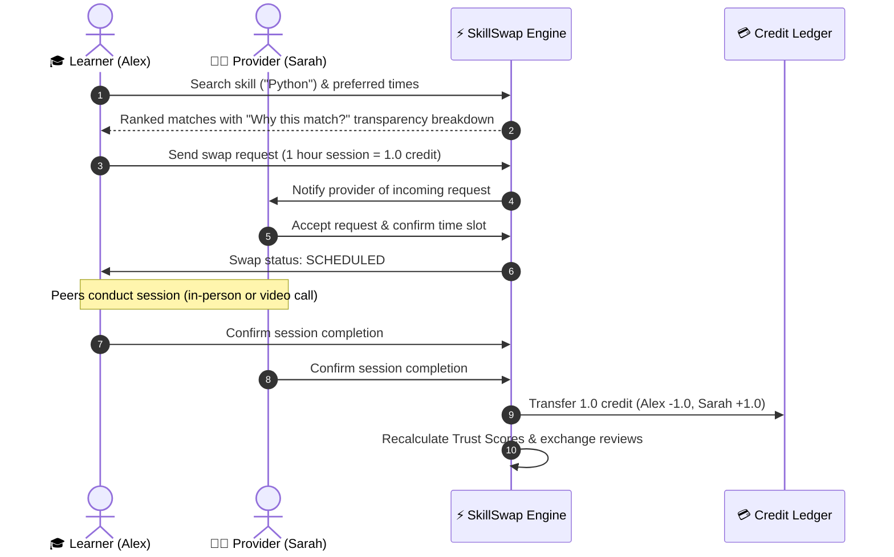

# 🎓 SkillSwap — Campus Peer Skill Barter & Exchange Platform

[](https://nextjs.org/)
[](https://react.dev/)
[](https://www.typescriptlang.org/)
[](https://tailwindcss.com/)
[](https://www.prisma.io/)
[](https://vitest.dev/)
[](LICENSE)

**SkillSwap** is a decentralized, trust-aware peer skill barter network engineered specifically for university campuses. It connects college students who want to learn practical skills (programming, design, public speaking, interview prep, course tutoring) with student peers who can teach them—**with zero real money involved**.

Instead of cash, exchanges are governed by a **non-monetary time-credit economy** and an **explainable, trust-weighted matching engine**.

---

## 📑 Table of Contents

- [Key Features](#-key-features)
- [How It Works](#-how-it-works)
- [System Architecture & File Structure](#-system-architecture--file-structure)
- [Tech Stack](#-tech-stack)
- [Getting Started](#-getting-started)
  - [Prerequisites](#prerequisites)
  - [Installation & Setup](#installation--setup)
  - [Database Migration & Seeding](#database-migration--seeding)
  - [Running the Application](#running-the-application)
  - [Running Unit Tests](#running-unit-tests)
- [Demo Credentials](#-demo-credentials)
- [Matching Algorithm & Trust Model](#-matching-algorithm--trust-model)
- [API Routes Reference](#-api-routes-reference)
- [Contributing](#-contributing)
- [License](#-license)

---

## ✨ Key Features

### 1. 🎯 Explainable Algorithmic Matching
- **Deterministic Peer Scoring:** Matches learners to providers based on exact vs. category skill relevance, skill proficiency differentials, schedule availability overlap, response times, and campus verification.
- **"Why This Match?" Transparency Panel:** Complete scoring transparency that breaks down trust points, rating points, schedule overlap, and proficiency compatibility. No opaque algorithmic black boxes.

### 2. 💳 Non-Monetary Credit Economy
- **Fair Credit Ledger:** Every new student receives **5.0 starting credits** upon onboarding.
- **Time-Based Rates:** Sessions cost 0.5 credits for 30 minutes, 0.75 credits for 45 minutes, or 1.0 credit for 60 minutes.
- **Double-Entry Auditable Ledger:** Every transaction logs an immutable `CreditTransaction` entry with before-and-after balances and idempotency keys to guarantee ledger integrity.

### 3. 🛡️ Trust & Campus Verification System
- **Multi-Factor Trust Metric:** Combines session completion rate (30%), student peer ratings (40%), verified campus ID status (20%), and network tenure/responsiveness (10%).
- **Cold-Start Protection:** Fresh accounts start with a neutral baseline trust score (0.50) so new learners are never locked out of discovering peers.

### 4. 🔄 Complete End-to-End Swap Lifecycle
- **Status Workflow:** `PENDING` ➔ `ACCEPTED` ➔ `SCHEDULED` ➔ `IN_PROGRESS` ➔ `COMPLETED` (or `CANCELLED` / `DISPUTED`).
- **Mutual Completion Handshake:** Both learner and mentor confirm session fulfillment before credits automatically transfer between wallets.
- **Integrated In-App Messaging:** Discuss goals, shared docs, meeting locations, and calendar times directly within each swap room.
- **Post-Session Reviews:** 1–5 star reviews with written feedback attached to public student profiles.

### 5. 📊 Interactive Student Dashboard & Wallet
- View upcoming sessions, track pending exchange invitations, monitor skill catalog updates, and audit credit balance history.
- Real-time notification feed for swap requests, schedule updates, and credit earnings.

---

## 🔄 How It Works



---

## 🗂️ System Architecture & File Structure

The project follows a clean, modular Next.js App Router structure with dedicated feature modules:

```
skillswap/
├── .env.example                 # Environment variables template
├── .gitignore                   # Clean ignore rules (excludes db, env, cache)
├── AGENTS.md                    # Environment-specific agent guidelines
├── eslint.config.mjs            # ESLint configuration
├── next.config.ts               # Next.js configuration
├── package.json                 # Project dependencies & scripts
├── postcss.config.mjs           # PostCSS configuration
├── tsconfig.json                # TypeScript compiler config
├── prisma/
│   ├── dev.db                   # Local SQLite database (ignored in git)
│   ├── schema.prisma            # SQLite schema (default for local development)
│   ├── schema.postgresql.prisma # PostgreSQL production schema template
│   └── seed.ts                  # Comprehensive mock seed script (8 student profiles)
├── public/                      # Static assets & icons
├── src/
│   ├── app/                     # Next.js App Router pages & APIs
│   │   ├── api/
│   │   │   ├── auth/            # Auth endpoints (login, signup, me, logout)
│   │   │   ├── matches/         # Matching engine recommendations API
│   │   │   ├── notifications/   # In-app notifications API
│   │   │   ├── peers/           # Student profile exploration API
│   │   │   ├── ratings/         # Session review & ratings API
│   │   │   ├── skills/          # Canonical skills catalog API
│   │   │   ├── swaps/           # Swap creation, status transitions, messages
│   │   │   └── wallet/          # Credit ledger & balance API
│   │   ├── dashboard/           # Student dashboard view
│   │   ├── explore/             # Browse skills & campus mentors
│   │   ├── login/               # Campus student authentication page
│   │   ├── matches/             # Algorithmic matching interface
│   │   ├── sessions/            # Swap room, live chat, completion handshake
│   │   ├── signup/              # New student onboarding page
│   │   ├── wallet/              # Non-monetary credit wallet & ledger
│   │   ├── globals.css          # Core styles & Tailwind directives
│   │   ├── layout.tsx           # Root navigation & layout shell
│   │   └── page.tsx             # Interactive landing page
│   ├── components/
│   │   ├── layout/              # Header, navigation, and footer components
│   │   └── ui/                  # Reusable UI primitives (badges, cards, modals)
│   ├── features/
│   │   ├── matching/            # Matching engine algorithms, scoring & types
│   │   ├── swaps/               # Swap state machine logic
│   │   └── wallet/              # Credit settlement & transaction logic
│   ├── lib/
│   │   ├── auth.ts              # JWT signing, cookie verification & hashing
│   │   └── db.ts                # Prisma Client singleton
│   └── types/                   # Shared TypeScript definitions
└── tests/
    └── matching-engine.test.ts  # Vitest test suite for trust & match scoring
```

---

## 🛠️ Tech Stack

| Layer | Technology | Description |
| :--- | :--- | :--- |
| **Frontend Framework** | **Next.js 16 (App Router)** | Server Components, Client Components, and dynamic streaming |
| **UI Library** | **React 19** | Modern reactive interfaces and state handling |
| **Language** | **TypeScript 5** | End-to-end type safety |
| **Styling** | **Tailwind CSS v4** | Modern responsive design with glassmorphism & gradients |
| **Icons** | **Lucide React** | Clean, accessible iconography |
| **ORM & Database** | **Prisma 6 & SQLite / PostgreSQL** | Zero-config SQLite local development; Postgres ready for production |
| **Authentication** | **JOSE (JWT) + Bcrypt** | Secure stateless JWT cookies and salted password hashing |
| **Testing** | **Vitest 3** | Fast unit test execution for core matching algorithms |

---

## 🚀 Getting Started

### Prerequisites

- **Node.js** `v18.18+` or `v20+`
- **npm** `v9+` (or `pnpm` / `yarn`)

### Installation & Setup

1. **Clone the repository:**
   ```bash
   git clone https://github.com/dharanivavilla28/skill-swap.git
   cd skill-swap
   ```

2. **Install dependencies:**
   ```bash
   npm install
   ```

3. **Configure environment variables:**
   ```bash
   cp .env.example .env
   ```
   *(The default `.env.example` includes a ready-to-run SQLite configuration for zero-setup local development).*

### Database Migration & Seeding

1. **Generate Prisma Client:**
   ```bash
   npm run prisma:generate
   ```

2. **Push schema to local database:**
   ```bash
   npm run prisma:push
   ```

3. **Seed mock campus dataset:**
   ```bash
   npm run seed
   ```
   This will populate **8 diverse student profiles**, canonical skill listings, completed swap histories, verified reviews, and credit transactions.

### Running the Application

Start the local development server:
```bash
npm run dev
```

Open [http://localhost:3000](http://localhost:3000) in your browser.

### Running Unit Tests

Run the Vitest test suite to verify matching and scoring algorithms:
```bash
npm test
```

---

## 👥 Demo Credentials

You can test different user personas using the seeded accounts below (all accounts share the password: `demopassword123`):

| Name | Email | Role / Skills | Balance | Trust |
| :--- | :--- | :--- | :--- | :--- |
| **Alex Rivera** *(Default)* | `demo@skillswap.edu` | Wants Python, Offers Canva & Storytelling | 5.0 cr | 72% |
| **Sarah Chen** | `sarah.chen@skillswap.edu` | Offers Advanced Python & Data Analysis | 9.5 cr | 94% |
| **Marcus Vance** | `marcus.v@skillswap.edu` | Offers Public Speaking & Interview Prep | 8.0 cr | 91% |
| **Priya Patel** | `priya.patel@skillswap.edu` | Offers Figma & UI/UX Design | 7.25 cr | 88% |
| **David Kim** | `david.kim@skillswap.edu` | Offers Web Dev (React) & Java Tutoring | 6.5 cr | 85% |
| **Elena Rostova** | `elena.r@skillswap.edu` | Offers Video Editing & Visual Storytelling | 5.5 cr | 76% |

---

## 🧮 Matching Algorithm & Trust Model

The SkillSwap Matching Engine ranks prospective mentors using a transparent multi-dimensional utility function:

$$\text{Total Match Score} = S_{\text{relevance}} + S_{\text{availability}} + S_{\text{rating}} + S_{\text{trust}} + S_{\text{response}}$$

1. **Skill Relevance ($S_{\text{relevance}}$, 0–40 pts):**
   - Exact Skill Match: 35 points + proficiency level bonus (up to 40 pts).
   - Related Category Match: 18 points.
2. **Availability Overlap ($S_{\text{availability}}$, 0–15 pts):**
   - Evaluates schedule intersections across student day and time blocks (5 pts per overlap, max 15 pts).
3. **Peer Rating Score ($S_{\text{rating}}$, 0–25 pts):**
   - Scaled from 5-star review average: $\left(\frac{\text{Rating}}{5.0}\right) \times 25$.
   - Unrated new users receive a neutral default score of 15 points.
4. **Trust Score ($S_{\text{trust}}$, 0–10 pts):**
   - Calculated via:
     $$T = 0.4 \times R_{\text{rating}} + 0.3 \times C_{\text{completion}} + 0.2 \times V_{\text{verified}} + 0.1 \times N_{\text{responsiveness}}$$
5. **Response Speed ($S_{\text{response}}$, 0–10 pts):**
   - Sub-hour response time awards full 10 pts; gradual decay for longer averages.

---

## 📡 API Routes Reference

| Endpoint | Method | Description |
| :--- | :--- | :--- |
| `/api/auth/signup` | `POST` | Register a new campus student account |
| `/api/auth/login` | `POST` | Authenticate and issue secure session cookie |
| `/api/auth/me` | `GET` | Get authenticated user profile & balance |
| `/api/skills` | `GET`, `POST` | Query canonical skills and register user skills |
| `/api/peers` | `GET` | Query student mentor directory with filters |
| `/api/matches` | `POST` | Run algorithmic matching engine with breakdown |
| `/api/swaps` | `GET`, `POST` | List student swaps or initiate a new swap request |
| `/api/swaps/[id]` | `GET`, `PATCH` | Retrieve swap details or update lifecycle status |
| `/api/swaps/[id]/complete` | `POST` | Submit mutual completion confirmation & settle credits |
| `/api/swaps/[id]/messages` | `GET`, `POST` | Real-time chat messages for an active swap |
| `/api/wallet` | `GET` | Retrieve wallet balance and transaction ledger |
| `/api/notifications` | `GET`, `PATCH` | Read notifications feed and mark as read |

---

## 🤝 Contributing

Contributions are welcome! Please follow these steps:

1. Fork the repository.
2. Create your feature branch (`git checkout -b feature/amazing-feature`).
3. Commit your changes (`git commit -m "Add amazing feature"`).
4. Run tests to ensure all checks pass (`npm test`).
5. Push to your branch (`git push origin feature/amazing-feature`).
6. Open a Pull Request.

---

## 📄 License

This project is open-source and licensed under the [MIT License](LICENSE).
